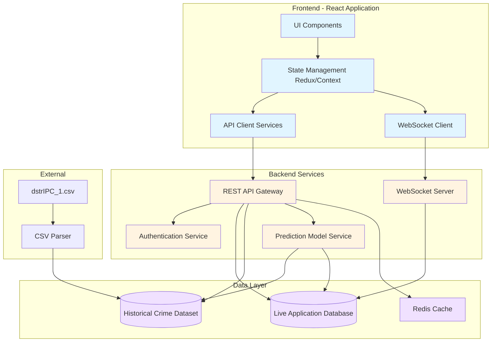
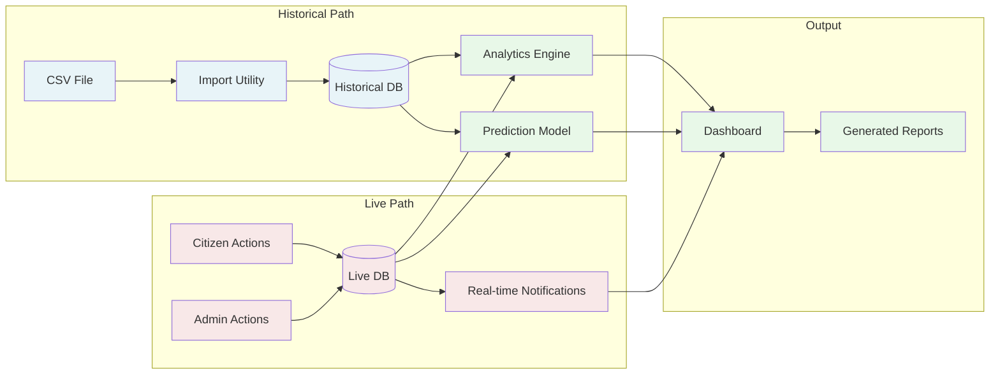
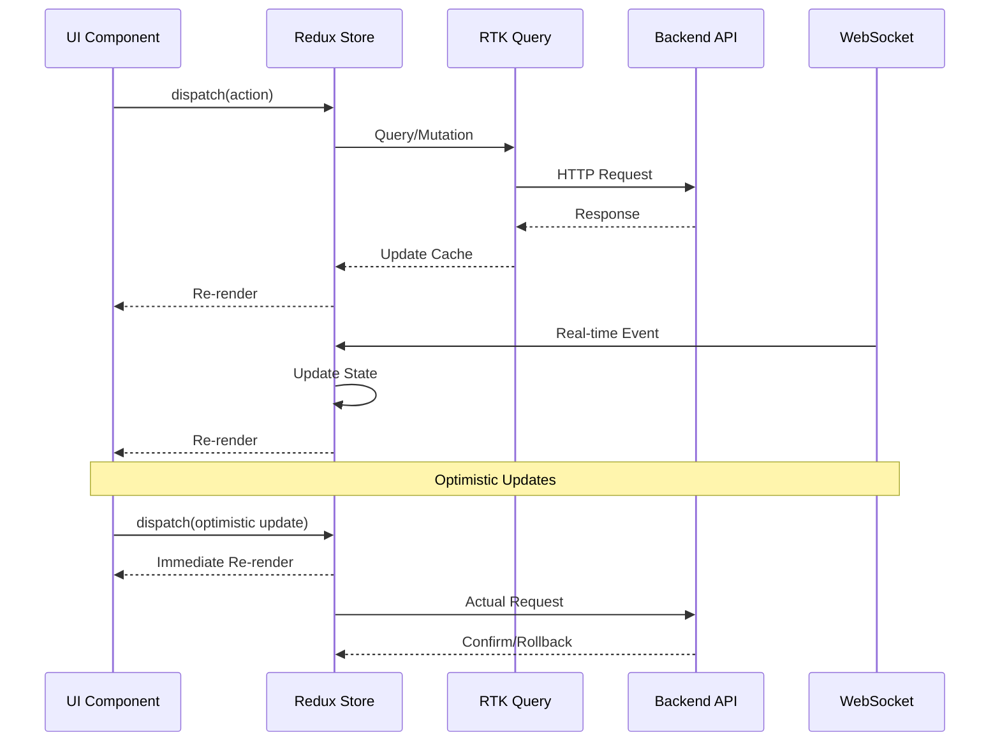

# Design Document: Admin Dashboard Implementation

## Overview

The Admin Dashboard is a comprehensive crime management and prediction system that transforms a prototype dashboard into a fully functional application for law enforcement administrators. The system integrates historical crime data from a CSV dataset (dstrIPC_1.csv) with live operational data to provide real-time analytics, predictive insights, case management, and emergency response capabilities.

### System Purpose

The dashboard serves police administrators who need to:
- Monitor crime trends across districts and time periods
- Manage FIRs (First Information Reports) and investigation cases
- Deploy officers strategically based on predictions and risk scores
- Respond to real-time SOS alerts from citizens
- Make data-driven decisions using both historical patterns and current incidents
- Generate comprehensive reports for stakeholders

### Key Characteristics

**Dual Data Source Architecture**: The system operates on two distinct data sources:
1. **Historical_Crime_Dataset**: Read-only CSV data providing years of crime statistics by state, district, year, and crime type
2. **Live_Application_Database**: Real-time operational database storing current FIRs, cases, users, officers, SOS alerts, and notifications

**Real-Time Operations**: The dashboard provides live updates for SOS alerts, officer tracking, and notification delivery through WebSocket connections or polling mechanisms.

**Predictive Analytics**: An integrated AI/ML prediction service analyzes both historical patterns and recent incidents to forecast future crime trends and generate risk scores.

**Comprehensive CRUD Operations**: Full create, read, update, delete capabilities for all operational entities including FIRs, cases, users, officers, and crime reports.

## Architecture

### System Architecture Diagram



### Architectural Layers

**Presentation Layer (React Frontend)**
- React 19 components with TypeScript for type safety
- Vite for fast build and hot module replacement
- React Router v6 for client-side routing
- Recharts for data visualization
- Leaflet with React-Leaflet for interactive maps
- Tailwind CSS for responsive styling

**State Management Layer**
- Redux Toolkit for centralized application state
- RTK Query for efficient data fetching and caching
- Normalized state structure for entities (FIRs, cases, officers, etc.)
- Optimistic updates for responsive UI
- Cross-tab synchronization using BroadcastChannel API

**API Communication Layer**
- Axios-based HTTP client with interceptors
- Request/response transformation
- Automatic retry logic for failed requests
- Request debouncing for search operations
- JWT token management and refresh

**Backend Services Layer**
- RESTful API endpoints following REST conventions
- JWT-based authentication with role-based access control
- AI/ML prediction service (Python-based with scikit-learn or similar)
- WebSocket server for real-time updates

**Data Access Layer**
- PostgreSQL for Live_Application_Database
- Read-only PostgreSQL table for Historical_Crime_Dataset
- Redis for session storage and API response caching
- ORM (Prisma or TypeORM) for database operations

### Data Flow Architecture




## Components and Interfaces

### Component Hierarchy

```mermaid
graph TD
    APP[App Root]
    
    APP --> AUTH_GUARD[AuthGuard]
    APP --> LAYOUT[DashboardLayout]
    
    AUTH_GUARD --> LOGIN[LoginPage]
    
    LAYOUT --> NAV[TopNavigation]
    LAYOUT --> SIDEBAR[Sidebar]
    LAYOUT --> CONTENT[PageContent]
    
    NAV --> NOTIF_DROPDOWN[NotificationDropdown]
    NAV --> PROFILE_DROPDOWN[ProfileDropdown]
    
    CONTENT --> DASH_PAGE[DashboardPage]
    CONTENT --> FIR_PAGE[FIRManagementPage]
    CONTENT --> CASE_PAGE[CaseManagementPage]
    CONTENT --> ANALYTICS_PAGE[AnalyticsPage]
    CONTENT --> PREDICT_PAGE[PredictionPage]
    CONTENT --> MAP_PAGE[HeatmapPage]
    CONTENT --> USERS_PAGE[UserManagementPage]
    CONTENT --> OFFICERS_PAGE[OfficerManagementPage]
    CONTENT --> REPORTS_PAGE[CrimeReportsPage]
    CONTENT --> SOS_PAGE[SOSAlertsPage]
    CONTENT --> SETTINGS_PAGE[SettingsPage]
    CONTENT --> AUDIT_PAGE[AuditLogsPage]
    
    DASH_PAGE --> INSIGHT_CARD[InsightCard]
    DASH_PAGE --> CRIME_CHART[CrimeChart]
    DASH_PAGE --> MINI_MAP[MiniHeatmap]
    DASH_PAGE --> RECENT_TABLE[RecentCrimesTable]
    
    FIR_PAGE --> DATA_TABLE[DataTable]
    FIR_PAGE --> FIR_FORM[FIRForm]
    FIR_PAGE --> FIR_DETAIL[FIRDetailDrawer]
    
    ANALYTICS_PAGE --> FILTER_BAR[FilterBar]
    ANALYTICS_PAGE --> TREND_CHART[TrendChart]
    ANALYTICS_PAGE --> COMPARISON_CHART[ComparisonChart]
    
    MAP_PAGE --> LEAFLET_MAP[LeafletMap]
    MAP_PAGE --> LAYER_CONTROL[LayerControl]
    MAP_PAGE --> MAP_LEGEND[MapLegend]
    
    classDef page fill:#e1f5ff
    classDef component fill:#fff4e1
    classDef shared fill:#f0e1ff
    
    class DASH_PAGE,FIR_PAGE,CASE_PAGE,ANALYTICS_PAGE,PREDICT_PAGE,MAP_PAGE,USERS_PAGE,OFFICERS_PAGE,REPORTS_PAGE,SOS_PAGE,SETTINGS_PAGE,AUDIT_PAGE page
    class NAV,SIDEBAR,INSIGHT_CARD,CRIME_CHART,FIR_FORM,FIR_DETAIL,FILTER_BAR,TREND_CHART,LEAFLET_MAP component
    class DATA_TABLE,AUTH_GUARD,LAYOUT shared
```



### Core Shared Components

#### DataTable Component

**Purpose**: Universal table component used across all management pages with consistent search, filter, sort, and pagination capabilities.

**Props Interface**:
```typescript
interface DataTableProps<T> {
  columns: Column<T>[];
  data: T[];
  loading: boolean;
  error?: string;
  onSearch?: (query: string) => void;
  onFilter?: (filters: Record<string, any>) => void;
  onSort?: (field: string, direction: 'asc' | 'desc') => void;
  onPageChange?: (page: number) => void;
  onPageSizeChange?: (size: number) => void;
  onRowClick?: (row: T) => void;
  onRowSelect?: (selectedRows: T[]) => void;
  bulkActions?: BulkAction<T>[];
  exportOptions?: ExportOption[];
  currentPage: number;
  pageSize: number;
  totalRecords: number;
}
```

**Features**:
- Checkbox selection (single and multi-select)
- Column sorting with visual indicators
- Search with 300ms debounce
- Multi-criteria filtering
- Pagination controls (10/25/50/100 per page)
- Bulk action toolbar
- Export to CSV/Excel/PDF
- Empty state and error state handling
- Responsive card layout for mobile

#### InsightCard Component

**Purpose**: Clickable dashboard metric card with icon, value, label, and action button.

**Props Interface**:
```typescript
interface InsightCardProps {
  icon: ReactNode;
  label: string;
  value: number | string;
  trend?: { direction: 'up' | 'down', percentage: number };
  actionLabel?: string;
  onClick?: () => void;
  loading?: boolean;
  variant?: 'default' | 'warning' | 'danger' | 'success';
}
```

#### FilterBar Component

**Purpose**: Reusable filter interface with date pickers, dropdowns, and clear all functionality.

**Props Interface**:
```typescript
interface FilterBarProps {
  filters: FilterConfig[];
  values: Record<string, any>;
  onChange: (filterName: string, value: any) => void;
  onClear: () => void;
  onApply: () => void;
}

interface FilterConfig {
  name: string;
  label: string;
  type: 'text' | 'select' | 'daterange' | 'multiselect';
  options?: { label: string; value: any }[];
  placeholder?: string;
}
```

#### FormModal Component

**Purpose**: Reusable modal dialog for forms with validation, loading states, and error handling.

**Props Interface**:
```typescript
interface FormModalProps {
  isOpen: boolean;
  title: string;
  onClose: () => void;
  onSubmit: (data: any) => Promise<void>;
  fields: FormField[];
  initialData?: Record<string, any>;
  submitLabel?: string;
  loading?: boolean;
}
```

### Page Components

#### DashboardPage

**Purpose**: Main overview page displaying key metrics, recent crimes, charts, and mini heatmap.

**Composed of**:
- 6 InsightCard components (Total FIRs, Active Cases, Pending Reports, Active Officers, SOS Alerts, Solved Cases)
- CrimeTypeChart (pie/bar chart showing crime distribution)
- DistrictAnalysisChart (bar chart of crimes by district)
- TrendLineChart (temporal trends)
- MiniHeatmap (small map preview)
- RecentCrimesTable (last 10 crimes with quick actions)

**State Requirements**:
```typescript
interface DashboardState {
  statistics: {
    totalFIRs: number;
    activeCases: number;
    pendingReports: number;
    activeOfficers: number;
    sosAlerts: number;
    solvedCases: number;
    historicalCrimes: number;
  };
  recentCrimes: Crime[];
  districtAnalysis: { district: string; count: number }[];
  crimeTypeBreakdown: { type: string; count: number }[];
  trends: { date: string; count: number }[];
  loading: boolean;
  error?: string;
}
```

#### FIRManagementPage

**Purpose**: Complete CRUD interface for First Information Reports.

**Composed of**:
- DataTable with FIR columns
- FIRForm modal for create/edit
- FIRDetailDrawer for viewing full details
- FilterBar with status, district, crime type, date range, assigned officer
- Bulk action toolbar for assign/delete/status change
- Export buttons

**Actions**:
- Create new FIR
- View FIR details
- Edit FIR information
- Assign officer to FIR
- Update FIR status (Pending/Investigation/Solved/Closed)
- Close FIR with reason
- Delete FIR (with confirmation)
- Bulk operations

#### AnalyticsPage

**Purpose**: Interactive data visualization with filtering capabilities.

**Composed of**:
- FilterBar (date range, district, crime type)
- TrendChart (line chart showing temporal patterns)
- ComparisonChart (bar chart comparing districts or crime types)
- SeasonalChart (monthly patterns averaged across years)
- HeatmapPreview (geographic distribution)
- StatisticsGrid (derived metrics)

**Features**:
- Dynamic filter application updates all visualizations
- Hybrid data display (historical + live)
- Chart interactions (hover tooltips, zoom, export)
- Data source labels (Historical/Live/Combined)

#### PredictionPage

**Purpose**: AI-powered crime forecasting and risk scoring interface.

**Composed of**:
- PredictionForm (district, crime type, month selectors)
- ForecastResultCard (predicted count, confidence, trend direction)
- ForecastChart (historical + projected line chart with confidence bands)
- RecommendationsPanel (AI-generated deployment suggestions)
- RiskScoreMap (heatmap with risk levels)
- HistoricalComparisonTable

**Prediction Display**:
```typescript
interface PredictionResult {
  forecastedCount: number;
  confidence: number; // 0-100
  trendDirection: 'increasing' | 'decreasing' | 'stable';
  percentageChange: number;
  peakDays: string[];
  contributingFactors: string[];
  recommendations: {
    officerCount: number;
    patrolShifts: string[];
    priorityAreas: string[];
    preventiveMeasures: string[];
  };
}
```

#### HeatmapPage

**Purpose**: Interactive geographic visualization with multiple layers and real-time updates.

**Composed of**:
- LeafletMap component
- LayerControl (toggles for each layer)
- MapLegend (color codes and marker explanations)
- LocationSearch
- ZoomControls
- MarkerPopups (detailed information on click)

**Map Layers**:
1. **District Boundaries**: SVG overlays with labels
2. **Crime Heatmap**: Color-coded density using intensity gradient
3. **Crime Clusters**: Marker clusters that expand on zoom
4. **Individual Crimes**: Individual markers with crime type icons
5. **SOS Locations**: Real-time pulsing red markers
6. **Patrol Routes**: Polylines showing officer paths
7. **Prediction Zones**: Shaded polygons for high-risk areas

**Marker Popup Content**:
```typescript
interface CrimeMarkerPopup {
  firNumber: string;
  crimeType: string;
  date: string;
  location: string;
  status: string;
  assignedOfficer?: string;
  actions: {
    viewDetails: () => void;
    assignOfficer: () => void;
  };
}

interface SOSMarkerPopup {
  alertId: string;
  userName: string;
  phone: string;
  timestamp: string;
  status: string;
  actions: {
    dispatch: () => void;
    viewDetails: () => void;
  };
}
```

#### UserManagementPage

**Purpose**: Manage citizen user accounts with full CRUD operations.

**Composed of**:
- DataTable with user columns (name, email, phone, role, status, registration date)
- UserForm modal
- FilterBar (role, status, registration date)
- Bulk actions (suspend, activate, delete)

**User Fields**:
```typescript
interface User {
  id: string;
  name: string;
  email: string;
  phone: string;
  address: string;
  role: 'citizen' | 'admin' | 'officer' | 'viewer';
  status: 'active' | 'suspended' | 'inactive';
  registrationDate: Date;
  lastLogin?: Date;
}
```

#### OfficerManagementPage

**Purpose**: Manage police officer records and assignments.

**Composed of**:
- DataTable with officer columns
- OfficerForm modal
- AssignmentDialog (select FIRs/cases to assign)
- TransferDialog (change district)
- FilterBar (district, rank, status, specialization)

**Officer Fields**:
```typescript
interface Officer {
  id: string;
  badgeNumber: string;
  name: string;
  rank: string;
  district: string;
  phone: string;
  specialization: string[];
  status: 'active' | 'inactive' | 'on-leave';
  assignedFIRs: string[];
  assignedCases: string[];
  currentLocation?: { lat: number; lng: number };
  lastUpdate?: Date;
}
```

#### CrimeReportsPage

**Purpose**: Review and moderate citizen-submitted crime reports.

**Composed of**:
- DataTable with report columns
- ReportDetailDrawer (full report with evidence)
- ApprovalButtons (approve/reject)
- AssignmentDialog
- RejectionReasonModal
- FilterBar (status, crime type, date)

**Crime Report Actions**:
- Approve → creates FIR, updates statistics
- Reject → marks rejected, notifies submitter, requires reason
- Assign Officer → creates assignment
- Delete → permanent removal with confirmation


#### SOSAlertsPage

**Purpose**: Real-time monitoring and response to emergency alerts.

**Composed of**:
- AlertsTable with auto-refresh
- AlertDetailPanel with map location
- DispatchDialog (nearby officers)
- StatusUpdateControls
- ResponseTimeDisplay
- FilterBar (status, time range)

**SOS Alert Structure**:
```typescript
interface SOSAlert {
  id: string;
  userId: string;
  userName: string;
  userPhone: string;
  latitude: number;
  longitude: number;
  timestamp: Date;
  status: 'pending' | 'assigned' | 'in-progress' | 'resolved' | 'cancelled';
  assignedOfficerId?: string;
  responseTime?: number; // seconds
  resolutionNotes?: string;
}
```

#### SettingsPage

**Purpose**: System configuration and user preferences.

**Sections**:
1. **Notification Preferences**: Toggles for each notification type
2. **Display Settings**: Theme, refresh interval, default page size
3. **Data Management**: CSV import/export utilities
4. **Security Settings**: Password change, two-factor auth
5. **System Information**: Version, database status, performance metrics

#### AuditLogsPage

**Purpose**: Immutable activity logs for accountability.

**Composed of**:
- DataTable with log columns (timestamp, user, action, entity, changes)
- FilterBar (user, action type, entity type, date range)
- DetailDrawer showing old/new values
- Export functionality

### Navigation Components

#### TopNavigation

**Layout**: Horizontal bar fixed at top with logo, search, notifications, settings, profile.

**Elements**:
- App logo (clickable → dashboard)
- Global search input
- Notification bell icon with badge count
- Settings gear icon
- User profile avatar with dropdown
- Quick action buttons

**Notification Dropdown**:
```typescript
interface Notification {
  id: string;
  type: 'sos' | 'crime_report' | 'prediction' | 'system' | 'assignment';
  title: string;
  message: string;
  timestamp: Date;
  read: boolean;
  link?: string;
  priority: 'low' | 'normal' | 'high' | 'critical';
}
```

**Profile Dropdown Menu**:
- View Profile
- Account Settings
- Change Password
- Help & Documentation
- Logout

#### Sidebar

**Layout**: Vertical navigation with collapsible menu.

**Menu Structure**:
- Dashboard (home icon)
- FIR Management (document icon)
- Case Management (folder icon)
- Analytics (chart icon)
- Predictions (brain icon)
- Heatmap (map icon)
- Crime Reports (flag icon)
- SOS Alerts (alert icon) - with live badge
- User Management (users icon)
- Officer Management (shield icon)
- Audit Logs (history icon)
- Settings (cog icon)

**Features**:
- Active route highlighting
- Collapse/expand toggle
- Tooltips on hover when collapsed
- Live update badges on SOS and reports

### Utility Components

#### LoadingSkeleton

**Purpose**: Animated placeholder matching actual content layout.

**Variants**:
- CardSkeleton (for insight cards)
- TableSkeleton (for data tables)
- ChartSkeleton (for charts)
- MapSkeleton (for map)
- FormSkeleton (for forms)

#### EmptyState

**Purpose**: Friendly message when no data exists.

**Props**:
```typescript
interface EmptyStateProps {
  icon: ReactNode;
  title: string;
  message: string;
  actionLabel?: string;
  onAction?: () => void;
}
```

#### ErrorBoundary

**Purpose**: Catch React errors and display fallback UI.

**Fallback UI**:
- Error icon
- "Something went wrong" message
- Error details (in development)
- "Reload Page" button
- "Report Issue" button

#### ConfirmDialog

**Purpose**: Reusable confirmation modal for destructive actions.

**Props**:
```typescript
interface ConfirmDialogProps {
  isOpen: boolean;
  title: string;
  message: string;
  confirmLabel?: string;
  cancelLabel?: string;
  variant?: 'default' | 'danger' | 'warning';
  onConfirm: () => void;
  onCancel: () => void;
}
```

## Data Models

### Live Application Database Schema

#### Users Table

```sql
CREATE TABLE users (
  id UUID PRIMARY KEY DEFAULT gen_random_uuid(),
  name VARCHAR(255) NOT NULL,
  email VARCHAR(255) UNIQUE NOT NULL,
  phone VARCHAR(20) NOT NULL,
  address TEXT,
  password_hash VARCHAR(255) NOT NULL,
  role VARCHAR(50) NOT NULL CHECK (role IN ('citizen', 'admin', 'officer', 'super_admin', 'viewer')),
  status VARCHAR(50) NOT NULL DEFAULT 'active' CHECK (status IN ('active', 'suspended', 'inactive')),
  registration_date TIMESTAMP NOT NULL DEFAULT NOW(),
  last_login TIMESTAMP,
  created_at TIMESTAMP NOT NULL DEFAULT NOW(),
  updated_at TIMESTAMP NOT NULL DEFAULT NOW()
);

CREATE INDEX idx_users_email ON users(email);
CREATE INDEX idx_users_role ON users(role);
CREATE INDEX idx_users_status ON users(status);
```

#### Officers Table

```sql
CREATE TABLE officers (
  id UUID PRIMARY KEY DEFAULT gen_random_uuid(),
  user_id UUID REFERENCES users(id) ON DELETE CASCADE,
  badge_number VARCHAR(50) UNIQUE NOT NULL,
  rank VARCHAR(100) NOT NULL,
  district VARCHAR(255) NOT NULL,
  phone VARCHAR(20) NOT NULL,
  specialization TEXT[], -- Array of specializations
  status VARCHAR(50) NOT NULL DEFAULT 'active' CHECK (status IN ('active', 'inactive', 'on-leave')),
  current_latitude DECIMAL(10, 8),
  current_longitude DECIMAL(11, 8),
  last_location_update TIMESTAMP,
  created_at TIMESTAMP NOT NULL DEFAULT NOW(),
  updated_at TIMESTAMP NOT NULL DEFAULT NOW()
);

CREATE INDEX idx_officers_badge ON officers(badge_number);
CREATE INDEX idx_officers_district ON officers(district);
CREATE INDEX idx_officers_status ON officers(status);
CREATE INDEX idx_officers_location ON officers(current_latitude, current_longitude);
```

#### FIRs Table

```sql
CREATE TABLE firs (
  id UUID PRIMARY KEY DEFAULT gen_random_uuid(),
  fir_number VARCHAR(50) UNIQUE NOT NULL,
  crime_type VARCHAR(255) NOT NULL,
  incident_date TIMESTAMP NOT NULL,
  location TEXT NOT NULL,
  latitude DECIMAL(10, 8),
  longitude DECIMAL(11, 8),
  district VARCHAR(255) NOT NULL,
  complainant_name VARCHAR(255) NOT NULL,
  complainant_phone VARCHAR(20),
  complainant_email VARCHAR(255),
  description TEXT NOT NULL,
  status VARCHAR(50) NOT NULL DEFAULT 'pending' CHECK (status IN ('pending', 'investigation', 'solved', 'closed')),
  assigned_officer_id UUID REFERENCES officers(id) ON DELETE SET NULL,
  created_by UUID REFERENCES users(id) ON DELETE SET NULL,
  closure_reason TEXT,
  resolution_notes TEXT,
  created_at TIMESTAMP NOT NULL DEFAULT NOW(),
  updated_at TIMESTAMP NOT NULL DEFAULT NOW(),
  closed_at TIMESTAMP
);

CREATE INDEX idx_firs_number ON firs(fir_number);
CREATE INDEX idx_firs_status ON firs(status);
CREATE INDEX idx_firs_district ON firs(district);
CREATE INDEX idx_firs_crime_type ON firs(crime_type);
CREATE INDEX idx_firs_incident_date ON firs(incident_date);
CREATE INDEX idx_firs_assigned_officer ON firs(assigned_officer_id);
CREATE INDEX idx_firs_location ON firs(latitude, longitude);
```

#### Cases Table

```sql
CREATE TABLE cases (
  id UUID PRIMARY KEY DEFAULT gen_random_uuid(),
  case_number VARCHAR(50) UNIQUE NOT NULL,
  name VARCHAR(255) NOT NULL,
  description TEXT,
  priority VARCHAR(50) NOT NULL CHECK (priority IN ('low', 'medium', 'high', 'critical')),
  category VARCHAR(255),
  status VARCHAR(50) NOT NULL DEFAULT 'active' CHECK (status IN ('active', 'investigation', 'solved', 'archived', 'closed')),
  created_by UUID REFERENCES users(id) ON DELETE SET NULL,
  created_at TIMESTAMP NOT NULL DEFAULT NOW(),
  updated_at TIMESTAMP NOT NULL DEFAULT NOW(),
  closed_at TIMESTAMP
);

CREATE INDEX idx_cases_number ON cases(case_number);
CREATE INDEX idx_cases_status ON cases(status);
CREATE INDEX idx_cases_priority ON cases(priority);
```

#### Case FIR Links Table (Many-to-Many)

```sql
CREATE TABLE case_fir_links (
  case_id UUID REFERENCES cases(id) ON DELETE CASCADE,
  fir_id UUID REFERENCES firs(id) ON DELETE CASCADE,
  linked_at TIMESTAMP NOT NULL DEFAULT NOW(),
  PRIMARY KEY (case_id, fir_id)
);

CREATE INDEX idx_case_fir_case ON case_fir_links(case_id);
CREATE INDEX idx_case_fir_fir ON case_fir_links(fir_id);
```

#### Case Officer Assignments Table (Many-to-Many)

```sql
CREATE TABLE case_officers (
  case_id UUID REFERENCES cases(id) ON DELETE CASCADE,
  officer_id UUID REFERENCES officers(id) ON DELETE CASCADE,
  assigned_at TIMESTAMP NOT NULL DEFAULT NOW(),
  assigned_by UUID REFERENCES users(id) ON DELETE SET NULL,
  PRIMARY KEY (case_id, officer_id)
);

CREATE INDEX idx_case_officers_case ON case_officers(case_id);
CREATE INDEX idx_case_officers_officer ON case_officers(officer_id);
```

#### Crime Reports Table

```sql
CREATE TABLE crime_reports (
  id UUID PRIMARY KEY DEFAULT gen_random_uuid(),
  user_id UUID REFERENCES users(id) ON DELETE SET NULL,
  crime_type VARCHAR(255) NOT NULL,
  incident_date TIMESTAMP NOT NULL,
  location TEXT NOT NULL,
  latitude DECIMAL(10, 8),
  longitude DECIMAL(11, 8),
  district VARCHAR(255) NOT NULL,
  description TEXT NOT NULL,
  evidence_urls TEXT[], -- Array of file URLs
  status VARCHAR(50) NOT NULL DEFAULT 'pending' CHECK (status IN ('pending', 'approved', 'rejected')),
  reviewed_by UUID REFERENCES users(id) ON DELETE SET NULL,
  reviewed_at TIMESTAMP,
  rejection_reason TEXT,
  created_fir_id UUID REFERENCES firs(id) ON DELETE SET NULL,
  created_at TIMESTAMP NOT NULL DEFAULT NOW(),
  updated_at TIMESTAMP NOT NULL DEFAULT NOW()
);

CREATE INDEX idx_crime_reports_status ON crime_reports(status);
CREATE INDEX idx_crime_reports_user ON crime_reports(user_id);
CREATE INDEX idx_crime_reports_district ON crime_reports(district);
CREATE INDEX idx_crime_reports_date ON crime_reports(created_at);
```

#### SOS Alerts Table

```sql
CREATE TABLE sos_alerts (
  id UUID PRIMARY KEY DEFAULT gen_random_uuid(),
  user_id UUID REFERENCES users(id) ON DELETE SET NULL,
  latitude DECIMAL(10, 8) NOT NULL,
  longitude DECIMAL(11, 8) NOT NULL,
  location_address TEXT,
  status VARCHAR(50) NOT NULL DEFAULT 'pending' CHECK (status IN ('pending', 'assigned', 'in-progress', 'resolved', 'cancelled')),
  assigned_officer_id UUID REFERENCES officers(id) ON DELETE SET NULL,
  assigned_at TIMESTAMP,
  resolved_at TIMESTAMP,
  response_time INTEGER, -- Seconds from creation to assignment
  resolution_notes TEXT,
  created_at TIMESTAMP NOT NULL DEFAULT NOW(),
  updated_at TIMESTAMP NOT NULL DEFAULT NOW()
);

CREATE INDEX idx_sos_status ON sos_alerts(status);
CREATE INDEX idx_sos_user ON sos_alerts(user_id);
CREATE INDEX idx_sos_officer ON sos_alerts(assigned_officer_id);
CREATE INDEX idx_sos_created ON sos_alerts(created_at);
CREATE INDEX idx_sos_location ON sos_alerts(latitude, longitude);
```

#### Notifications Table

```sql
CREATE TABLE notifications (
  id UUID PRIMARY KEY DEFAULT gen_random_uuid(),
  user_id UUID REFERENCES users(id) ON DELETE CASCADE,
  type VARCHAR(50) NOT NULL CHECK (type IN ('sos', 'crime_report', 'prediction', 'system', 'assignment')),
  title VARCHAR(255) NOT NULL,
  message TEXT NOT NULL,
  read BOOLEAN NOT NULL DEFAULT FALSE,
  link TEXT,
  priority VARCHAR(50) NOT NULL DEFAULT 'normal' CHECK (priority IN ('low', 'normal', 'high', 'critical')),
  created_at TIMESTAMP NOT NULL DEFAULT NOW()
);

CREATE INDEX idx_notifications_user ON notifications(user_id);
CREATE INDEX idx_notifications_read ON notifications(read);
CREATE INDEX idx_notifications_type ON notifications(type);
CREATE INDEX idx_notifications_created ON notifications(created_at);
```

#### Audit Logs Table

```sql
CREATE TABLE audit_logs (
  id UUID PRIMARY KEY DEFAULT gen_random_uuid(),
  user_id UUID REFERENCES users(id) ON DELETE SET NULL,
  action VARCHAR(100) NOT NULL, -- CREATE, UPDATE, DELETE, LOGIN, LOGOUT
  entity_type VARCHAR(100) NOT NULL, -- FIR, CASE, USER, OFFICER, etc.
  entity_id UUID,
  old_values JSONB,
  new_values JSONB,
  ip_address VARCHAR(45),
  user_agent TEXT,
  created_at TIMESTAMP NOT NULL DEFAULT NOW()
);

CREATE INDEX idx_audit_user ON audit_logs(user_id);
CREATE INDEX idx_audit_action ON audit_logs(action);
CREATE INDEX idx_audit_entity ON audit_logs(entity_type, entity_id);
CREATE INDEX idx_audit_created ON audit_logs(created_at);
```

#### User Settings Table

```sql
CREATE TABLE user_settings (
  user_id UUID PRIMARY KEY REFERENCES users(id) ON DELETE CASCADE,
  theme VARCHAR(20) DEFAULT 'light' CHECK (theme IN ('light', 'dark')),
  notifications_enabled JSONB DEFAULT '{"sos": true, "crime_report": true, "prediction": true, "system": true, "assignment": true}',
  refresh_interval INTEGER DEFAULT 30, -- seconds
  default_page_size INTEGER DEFAULT 25,
  created_at TIMESTAMP NOT NULL DEFAULT NOW(),
  updated_at TIMESTAMP NOT NULL DEFAULT NOW()
);
```

### Historical Crime Dataset Schema

```sql
CREATE TABLE historical_crimes (
  id SERIAL PRIMARY KEY,
  state VARCHAR(255) NOT NULL,
  district VARCHAR(255) NOT NULL,
  year INTEGER NOT NULL,
  crime_type VARCHAR(255) NOT NULL,
  count INTEGER NOT NULL DEFAULT 0,
  created_at TIMESTAMP NOT NULL DEFAULT NOW()
);

CREATE INDEX idx_historical_state ON historical_crimes(state);
CREATE INDEX idx_historical_district ON historical_crimes(district);
CREATE INDEX idx_historical_year ON historical_crimes(year);
CREATE INDEX idx_historical_type ON historical_crimes(crime_type);
CREATE INDEX idx_historical_composite ON historical_crimes(district, year, crime_type);

-- Make table read-only after initial import
-- REVOKE INSERT, UPDATE, DELETE ON historical_crimes FROM public;
-- GRANT SELECT ON historical_crimes TO public;
```

### TypeScript Interfaces

#### Frontend Type Definitions

```typescript
// src/types/entities.ts

export interface User {
  id: string;
  name: string;
  email: string;
  phone: string;
  address: string;
  role: 'citizen' | 'admin' | 'officer' | 'super_admin' | 'viewer';
  status: 'active' | 'suspended' | 'inactive';
  registrationDate: Date;
  lastLogin?: Date;
}

export interface Officer {
  id: string;
  userId: string;
  badgeNumber: string;
  rank: string;
  district: string;
  phone: string;
  specialization: string[];
  status: 'active' | 'inactive' | 'on-leave';
  currentLocation?: {
    latitude: number;
    longitude: number;
    timestamp: Date;
  };
  assignedFIRs: string[];
  assignedCases: string[];
}

export interface FIR {
  id: string;
  firNumber: string;
  crimeType: string;
  incidentDate: Date;
  location: string;
  latitude?: number;
  longitude?: number;
  district: string;
  complainantName: string;
  complainantPhone?: string;
  complainantEmail?: string;
  description: string;
  status: 'pending' | 'investigation' | 'solved' | 'closed';
  assignedOfficerId?: string;
  assignedOfficer?: Officer;
  createdBy: string;
  closureReason?: string;
  resolutionNotes?: string;
  createdAt: Date;
  updatedAt: Date;
  closedAt?: Date;
}

export interface Case {
  id: string;
  caseNumber: string;
  name: string;
  description: string;
  priority: 'low' | 'medium' | 'high' | 'critical';
  category: string;
  status: 'active' | 'investigation' | 'solved' | 'archived' | 'closed';
  linkedFIRs: FIR[];
  assignedOfficers: Officer[];
  createdBy: string;
  createdAt: Date;
  updatedAt: Date;
  closedAt?: Date;
}

export interface CrimeReport {
  id: string;
  userId: string;
  user?: User;
  crimeType: string;
  incidentDate: Date;
  location: string;
  latitude?: number;
  longitude?: number;
  district: string;
  description: string;
  evidenceUrls: string[];
  status: 'pending' | 'approved' | 'rejected';
  reviewedBy?: string;
  reviewedAt?: Date;
  rejectionReason?: string;
  createdFIRId?: string;
  createdAt: Date;
}

export interface SOSAlert {
  id: string;
  userId: string;
  user?: User;
  latitude: number;
  longitude: number;
  locationAddress?: string;
  status: 'pending' | 'assigned' | 'in-progress' | 'resolved' | 'cancelled';
  assignedOfficerId?: string;
  assignedOfficer?: Officer;
  assignedAt?: Date;
  resolvedAt?: Date;
  responseTime?: number;
  resolutionNotes?: string;
  createdAt: Date;
}

export interface Notification {
  id: string;
  userId: string;
  type: 'sos' | 'crime_report' | 'prediction' | 'system' | 'assignment';
  title: string;
  message: string;
  read: boolean;
  link?: string;
  priority: 'low' | 'normal' | 'high' | 'critical';
  createdAt: Date;
}

export interface AuditLog {
  id: string;
  userId: string;
  user?: User;
  action: string;
  entityType: string;
  entityId: string;
  oldValues?: Record<string, any>;
  newValues?: Record<string, any>;
  ipAddress?: string;
  userAgent?: string;
  createdAt: Date;
}

export interface HistoricalCrime {
  id: number;
  state: string;
  district: string;
  year: number;
  crimeType: string;
  count: number;
}

export interface DashboardStatistics {
  totalFIRs: number;
  activeCases: number;
  pendingReports: number;
  activeOfficers: number;
  sosAlerts: number;
  solvedCases: number;
  historicalCrimes: number;
  todayIncidents: number;
}

export interface PredictionResult {
  district: string;
  crimeType: string;
  month: string;
  forecastedCount: number;
  confidence: number;
  trendDirection: 'increasing' | 'decreasing' | 'stable';
  percentageChange: number;
  peakDays: string[];
  contributingFactors: string[];
  historicalAverage: number;
  recentTrend: number;
  recommendations: {
    officerCount: number;
    patrolShifts: string[];
    priorityAreas: string[];
    preventiveMeasures: string[];
  };
}

export interface RiskScore {
  district: string;
  score: number; // 0-100
  level: 'low' | 'medium' | 'high' | 'critical';
  historicalRate: number;
  recentIncidents: number;
  contributingFactors: {
    factor: string;
    weight: number;
  }[];
  lastUpdated: Date;
}
```


## API Design

### REST API Endpoints

#### Authentication Endpoints

```
POST   /api/auth/login
POST   /api/auth/logout
POST   /api/auth/refresh
POST   /api/auth/forgot-password
POST   /api/auth/reset-password
GET    /api/auth/me
```

**Login Request/Response**:
```typescript
// POST /api/auth/login
Request: {
  email: string;
  password: string;
}

Response: {
  user: User;
  accessToken: string;
  refreshToken: string;
  expiresIn: number;
}
```

#### Dashboard Endpoints

```
GET    /api/dashboard/statistics
GET    /api/dashboard/recent-crimes
GET    /api/dashboard/district-analysis
GET    /api/dashboard/crime-type-breakdown
GET    /api/dashboard/trends
```

**Statistics Response**:
```typescript
// GET /api/dashboard/statistics
Response: {
  totalFIRs: number;
  activeCases: number;
  pendingReports: number;
  activeOfficers: number;
  sosAlerts: number;
  solvedCases: number;
  historicalCrimes: number;
  todayIncidents: number;
}
```

#### FIR Management Endpoints

```
GET    /api/firs?page=1&pageSize=25&search=&status=&district=&crimeType=&dateFrom=&dateTo=&sortBy=&sortOrder=
GET    /api/firs/:id
POST   /api/firs
PUT    /api/firs/:id
PATCH  /api/firs/:id/status
PATCH  /api/firs/:id/assign
PATCH  /api/firs/:id/close
DELETE /api/firs/:id
POST   /api/firs/bulk-delete
POST   /api/firs/bulk-assign
POST   /api/firs/export
```

**FIR List Response**:
```typescript
// GET /api/firs
Response: {
  data: FIR[];
  pagination: {
    page: number;
    pageSize: number;
    totalRecords: number;
    totalPages: number;
  };
  filters: Record<string, any>;
}
```

**Create FIR Request**:
```typescript
// POST /api/firs
Request: {
  crimeType: string;
  incidentDate: string; // ISO 8601
  location: string;
  latitude?: number;
  longitude?: number;
  district: string;
  complainantName: string;
  complainantPhone?: string;
  complainantEmail?: string;
  description: string;
}

Response: {
  fir: FIR;
  message: string;
}
```

#### Case Management Endpoints

```
GET    /api/cases?page=1&pageSize=25&search=&status=&priority=&sortBy=&sortOrder=
GET    /api/cases/:id
POST   /api/cases
PUT    /api/cases/:id
PATCH  /api/cases/:id/link-fir
PATCH  /api/cases/:id/unlink-fir
PATCH  /api/cases/:id/assign-officer
PATCH  /api/cases/:id/archive
DELETE /api/cases/:id
POST   /api/cases/bulk-operations
```

#### User Management Endpoints

```
GET    /api/users?page=1&pageSize=25&search=&role=&status=
GET    /api/users/:id
POST   /api/users
PUT    /api/users/:id
PATCH  /api/users/:id/suspend
PATCH  /api/users/:id/activate
DELETE /api/users/:id
POST   /api/users/bulk-operations
```

#### Officer Management Endpoints

```
GET    /api/officers?page=1&pageSize=25&search=&district=&status=&rank=
GET    /api/officers/:id
GET    /api/officers/:id/assignments
GET    /api/officers/:id/location-history
POST   /api/officers
PUT    /api/officers/:id
PATCH  /api/officers/:id/transfer
PATCH  /api/officers/:id/deactivate
PATCH  /api/officers/:id/location
DELETE /api/officers/:id
```

**Officer Location Update**:
```typescript
// PATCH /api/officers/:id/location
Request: {
  latitude: number;
  longitude: number;
  timestamp: string; // ISO 8601
}

Response: {
  success: boolean;
  officer: Officer;
}
```

#### Crime Reports Endpoints

```
GET    /api/crime-reports?page=1&pageSize=25&status=&district=&crimeType=
GET    /api/crime-reports/:id
POST   /api/crime-reports/:id/approve
POST   /api/crime-reports/:id/reject
POST   /api/crime-reports/:id/assign
DELETE /api/crime-reports/:id
```

**Approve Crime Report**:
```typescript
// POST /api/crime-reports/:id/approve
Request: {
  assignOfficerId?: string;
}

Response: {
  createdFIR: FIR;
  message: string;
}
```

**Reject Crime Report**:
```typescript
// POST /api/crime-reports/:id/reject
Request: {
  reason: string;
}

Response: {
  success: boolean;
  message: string;
}
```

#### SOS Alerts Endpoints

```
GET    /api/sos-alerts?page=1&pageSize=25&status=&dateFrom=&dateTo=
GET    /api/sos-alerts/:id
PATCH  /api/sos-alerts/:id/assign
PATCH  /api/sos-alerts/:id/update-status
POST   /api/sos-alerts/:id/resolve
GET    /api/sos-alerts/nearby-officers?lat=&lng=&radius=5
```

**Assign Officer to SOS**:
```typescript
// PATCH /api/sos-alerts/:id/assign
Request: {
  officerId: string;
}

Response: {
  alert: SOSAlert;
  responseTime: number;
  message: string;
}
```

**Nearby Officers**:
```typescript
// GET /api/sos-alerts/nearby-officers
Response: {
  officers: Array<{
    officer: Officer;
    distance: number; // kilometers
    estimatedArrival: number; // minutes
  }>;
}
```

#### Analytics Endpoints

```
GET    /api/analytics/crime-trends?dateFrom=&dateTo=&district=&crimeType=
GET    /api/analytics/district-comparison?year=&crimeType=
GET    /api/analytics/seasonal-patterns?district=&crimeType=
GET    /api/analytics/hotspots?district=&dateFrom=&dateTo=
GET    /api/analytics/historical?state=&district=&yearFrom=&yearTo=&crimeType=
GET    /api/analytics/combined?district=&crimeType=&dateFrom=&dateTo=
```

**Crime Trends Response**:
```typescript
// GET /api/analytics/crime-trends
Response: {
  trends: Array<{
    date: string;
    count: number;
    crimeType: string;
  }>;
  dataSource: 'historical' | 'live' | 'combined';
  summary: {
    total: number;
    average: number;
    peak: { date: string; count: number };
    trend: 'increasing' | 'decreasing' | 'stable';
  };
}
```

**Hotspots Response**:
```typescript
// GET /api/analytics/hotspots
Response: {
  hotspots: Array<{
    id: string;
    center: { latitude: number; longitude: number };
    radius: number; // kilometers
    crimeCount: number;
    dominantCrimeType: string;
    trend: 'increasing' | 'decreasing' | 'stable';
    crimes: FIR[];
  }>;
  detectedAt: string;
}
```

#### Prediction Endpoints

```
POST   /api/prediction/forecast
GET    /api/prediction/risk-score?district=&date=
GET    /api/prediction/deployment-recommendations?district=
GET    /api/prediction/history?district=&crimeType=
```

**Forecast Request/Response**:
```typescript
// POST /api/prediction/forecast
Request: {
  district: string;
  crimeType: string;
  month: string; // YYYY-MM
}

Response: {
  prediction: PredictionResult;
  chartData: {
    historical: Array<{ date: string; count: number }>;
    forecast: Array<{ date: string; count: number; confidenceLower: number; confidenceUpper: number }>;
  };
}
```

**Risk Score Response**:
```typescript
// GET /api/prediction/risk-score
Response: {
  riskScore: RiskScore;
  comparison: {
    neighboringDistricts: Array<{
      district: string;
      score: number;
    }>;
    historicalAverage: number;
  };
}
```

**Deployment Recommendations**:
```typescript
// GET /api/prediction/deployment-recommendations
Response: {
  recommendations: {
    officerCount: number;
    suggestedOfficers: Officer[];
    patrolShifts: Array<{
      shift: string;
      startTime: string;
      endTime: string;
      officerCount: number;
    }>;
    priorityAreas: Array<{
      area: string;
      coordinates: { latitude: number; longitude: number };
      riskLevel: string;
    }>;
    preventiveMeasures: string[];
  };
  validUntil: string;
}
```

#### Notifications Endpoints

```
GET    /api/notifications?page=1&pageSize=25&read=&type=
GET    /api/notifications/unread-count
PATCH  /api/notifications/:id/read
PATCH  /api/notifications/mark-all-read
DELETE /api/notifications/:id
```

#### Audit Logs Endpoints

```
GET    /api/audit-logs?page=1&pageSize=25&userId=&action=&entityType=&dateFrom=&dateTo=
GET    /api/audit-logs/:id
POST   /api/audit-logs/export
```

#### Settings Endpoints

```
GET    /api/settings
PUT    /api/settings
POST   /api/settings/reset
```

#### Data Import/Export Endpoints

```
POST   /api/import/historical-csv
GET    /api/import/status/:jobId
POST   /api/export/data
GET    /api/export/download/:fileId
```

**CSV Import**:
```typescript
// POST /api/import/historical-csv
Request: FormData {
  file: File;
  options: {
    skipDuplicates: boolean;
    validateOnly: boolean;
  };
}

Response: {
  jobId: string;
  status: 'processing' | 'completed' | 'failed';
  progress: number; // 0-100
  summary: {
    totalRows: number;
    processedRows: number;
    importedRows: number;
    skippedRows: number;
    errors: Array<{
      row: number;
      error: string;
    }>;
  };
}
```

### WebSocket Events

**Connection**: `ws://api-domain/ws?token=<jwt_token>`

#### Server → Client Events

```typescript
// New SOS Alert
{
  event: 'sos:new',
  data: SOSAlert
}

// SOS Status Update
{
  event: 'sos:update',
  data: SOSAlert
}

// New Crime Report
{
  event: 'crime-report:new',
  data: CrimeReport
}

// FIR Created/Updated
{
  event: 'fir:created' | 'fir:updated' | 'fir:deleted',
  data: FIR
}

// Officer Location Update
{
  event: 'officer:location',
  data: {
    officerId: string;
    latitude: number;
    longitude: number;
    timestamp: string;
  }
}

// New Notification
{
  event: 'notification:new',
  data: Notification
}

// Dashboard Statistics Update
{
  event: 'dashboard:update',
  data: DashboardStatistics
}

// Prediction Alert
{
  event: 'prediction:alert',
  data: {
    district: string;
    riskLevel: string;
    message: string;
  }
}
```

#### Client → Server Events

```typescript
// Subscribe to specific channels
{
  event: 'subscribe',
  data: {
    channels: ['sos', 'firs', 'officers', 'notifications']
  }
}

// Unsubscribe
{
  event: 'unsubscribe',
  data: {
    channels: ['officers']
  }
}

// Heartbeat
{
  event: 'ping',
  data: { timestamp: string }
}
```

### API Error Responses

**Standard Error Format**:
```typescript
{
  error: {
    code: string; // ERROR_CODE_CONSTANT
    message: string; // Human-readable message
    details?: any; // Additional context
    timestamp: string; // ISO 8601
  }
}
```

**Error Codes**:
- `AUTH_REQUIRED` (401): Authentication required
- `AUTH_INVALID` (401): Invalid credentials
- `AUTH_EXPIRED` (401): Session expired
- `FORBIDDEN` (403): Insufficient permissions
- `NOT_FOUND` (404): Resource not found
- `VALIDATION_ERROR` (400): Invalid request data
- `DUPLICATE` (409): Resource already exists
- `RATE_LIMIT` (429): Too many requests
- `SERVER_ERROR` (500): Internal server error
- `SERVICE_UNAVAILABLE` (503): Service temporarily unavailable

## State Management

### Redux Store Structure

```typescript
// src/store/index.ts

interface RootState {
  auth: AuthState;
  dashboard: DashboardState;
  firs: FIRsState;
  cases: CasesState;
  users: UsersState;
  officers: OfficersState;
  crimeReports: CrimeReportsState;
  sosAlerts: SOSAlertsState;
  notifications: NotificationsState;
  analytics: AnalyticsState;
  predictions: PredictionsState;
  settings: SettingsState;
  ui: UIState;
}
```

### State Slices

#### Auth Slice

```typescript
interface AuthState {
  user: User | null;
  accessToken: string | null;
  isAuthenticated: boolean;
  loading: boolean;
  error: string | null;
}

// Actions
- login(credentials: LoginCredentials)
- logout()
- refreshToken()
- updateProfile(data: Partial<User>)
```

#### Dashboard Slice

```typescript
interface DashboardState {
  statistics: DashboardStatistics | null;
  recentCrimes: FIR[];
  districtAnalysis: Array<{ district: string; count: number }>;
  crimeTypeBreakdown: Array<{ type: string; count: number }>;
  trends: Array<{ date: string; count: number }>;
  loading: boolean;
  error: string | null;
  lastUpdated: Date | null;
}

// Actions
- fetchStatistics()
- fetchRecentCrimes()
- fetchDistrictAnalysis()
- refreshDashboard()
- subscribeToDashboardUpdates()
```

#### FIRs Slice

```typescript
interface FIRsState {
  entities: Record<string, FIR>;
  ids: string[];
  selectedId: string | null;
  filters: {
    search: string;
    status: string;
    district: string;
    crimeType: string;
    dateFrom: string;
    dateTo: string;
    assignedOfficer: string;
  };
  sorting: {
    field: string;
    order: 'asc' | 'desc';
  };
  pagination: {
    page: number;
    pageSize: number;
    totalRecords: number;
    totalPages: number;
  };
  selectedIds: string[];
  loading: boolean;
  error: string | null;
}

// Actions
- fetchFIRs(params: FetchParams)
- fetchFIRById(id: string)
- createFIR(data: CreateFIRRequest)
- updateFIR(id: string, data: Partial<FIR>)
- deleteFIR(id: string)
- assignOfficer(firId: string, officerId: string)
- closeFIR(id: string, reason: string)
- bulkDelete(ids: string[])
- bulkAssign(ids: string[], officerId: string)
- setFilters(filters: Partial<FIRsState['filters']>)
- setSorting(field: string, order: 'asc' | 'desc')
- setPage(page: number)
- setPageSize(size: number)
- selectFIRs(ids: string[])
- clearSelection()
```

#### Notifications Slice

```typescript
interface NotificationsState {
  entities: Record<string, Notification>;
  ids: string[];
  unreadCount: number;
  filters: {
    type: string;
    read: boolean | null;
  };
  loading: boolean;
  error: string | null;
}

// Actions
- fetchNotifications(params: FetchParams)
- fetchUnreadCount()
- markAsRead(id: string)
- markAllAsRead()
- deleteNotification(id: string)
- addNotification(notification: Notification) // From WebSocket
- setFilters(filters: Partial<NotificationsState['filters']>)
```

#### UI Slice

```typescript
interface UIState {
  sidebarCollapsed: boolean;
  activeModal: string | null;
  modalData: any;
  toasts: Array<{
    id: string;
    type: 'success' | 'error' | 'warning' | 'info';
    message: string;
    duration: number;
  }>;
  confirmDialog: {
    isOpen: boolean;
    title: string;
    message: string;
    onConfirm: () => void;
  } | null;
}

// Actions
- toggleSidebar()
- openModal(modalName: string, data?: any)
- closeModal()
- showToast(type: string, message: string)
- hideToast(id: string)
- showConfirmDialog(config: ConfirmDialogConfig)
- hideConfirmDialog()
```

### RTK Query API Endpoints

```typescript
// src/store/api.ts

export const api = createApi({
  reducerPath: 'api',
  baseQuery: fetchBaseQuery({
    baseUrl: '/api',
    prepareHeaders: (headers, { getState }) => {
      const token = (getState() as RootState).auth.accessToken;
      if (token) {
        headers.set('authorization', `Bearer ${token}`);
      }
      return headers;
    },
  }),
  tagTypes: ['FIR', 'Case', 'User', 'Officer', 'CrimeReport', 'SOSAlert', 'Notification', 'AuditLog'],
  endpoints: (builder) => ({
    // FIR endpoints
    getFIRs: builder.query<FIRsResponse, FIRsQueryParams>({
      query: (params) => ({
        url: '/firs',
        params,
      }),
      providesTags: (result) =>
        result
          ? [
              ...result.data.map(({ id }) => ({ type: 'FIR' as const, id })),
              { type: 'FIR', id: 'LIST' },
            ]
          : [{ type: 'FIR', id: 'LIST' }],
    }),
    
    createFIR: builder.mutation<FIR, CreateFIRRequest>({
      query: (data) => ({
        url: '/firs',
        method: 'POST',
        body: data,
      }),
      invalidatesTags: [{ type: 'FIR', id: 'LIST' }],
    }),
    
    // ... more endpoints
  }),
});

export const {
  useGetFIRsQuery,
  useCreateFIRMutation,
  // ... more hooks
} = api;
```

### State Update Flow




## Correctness Properties

*A property is a characteristic or behavior that should hold true across all valid executions of a system—essentially, a formal statement about what the system should do. Properties serve as the bridge between human-readable specifications and machine-verifiable correctness guarantees.*

### Property 1: Notification UI Consistency

*For any* application state with unread notifications, the notification icon SHALL display a badge with the unread count, and clicking the icon SHALL display a dropdown listing all unread notifications.

**Validates: Requirements 1.1, 1.6**

### Property 2: Notification Read and Navigation

*For any* unread notification, clicking the notification item SHALL mark it as read (decrementing the unread count) and navigate to the linked page if a link exists.

**Validates: Requirements 1.2**

### Property 3: Session Termination

*For any* authenticated session, selecting logout from the profile dropdown SHALL invalidate the session token, clear authentication state, and redirect to the login page.

**Validates: Requirements 1.4**

### Property 4: Clickable Navigation Consistency

*For any* clickable UI element with a navigation target (insight cards, table rows, buttons), clicking the element SHALL navigate to the corresponding page or open the corresponding detail view.

**Validates: Requirements 2.1, 7.1**

### Property 5: Search Filtering

*For any* search query entered in a data table search field, the table SHALL filter and display only records where at least one searchable column contains the search term (case-insensitive).

**Validates: Requirements 5.1**

### Property 6: Column Sorting Ascending

*For any* sortable column in a data table, clicking the column header SHALL sort the table rows by that column in ascending order and display an ascending sort indicator.

**Validates: Requirements 6.1**

### Property 7: Sort Toggle

*For any* data table column currently sorted in ascending order, clicking the same column header again SHALL toggle the sort to descending order and update the sort indicator.

**Validates: Requirements 6.2**

### Property 8: Filter Application Consistency

*For any* filter selection (date range, district, crime type, etc.), all dependent visualizations (charts, tables, heatmaps) SHALL update to display only data matching the selected filter criteria.

**Validates: Requirements 8.1, 9.1**

### Property 9: Entity Creation Success

*For any* valid entity data (user, officer, FIR, case, etc.) submitted through a creation form, the system SHALL save the entity to the database, assign a unique identifier, and return the created entity with success confirmation.

**Validates: Requirements 15.1, 19.2**

### Property 10: Unique Identifier Generation

*For any* FIR creation, the system SHALL generate a unique FIR number that does not conflict with any existing FIR number in the database.

**Validates: Requirements 19.2**

### Property 11: Dashboard Statistic Updates

*For any* FIR creation or status change, the dashboard statistics SHALL update to reflect the new totals (incrementing FIR count, updating status counts, refreshing district analysis).

**Validates: Requirements 20.1**

### Property 12: API Response Caching

*For any* API GET request, the State_Management SHALL cache the response, and subsequent identical requests within 5 minutes SHALL return the cached response without making a new network request.

**Validates: Requirements 21.4**

### Property 13: Input Validation - Required Fields

*For any* form with required fields, submitting the form with empty required fields SHALL prevent submission, display field-specific error messages, and keep the form in an editable state.

**Validates: Requirements 45.1**

### Property 14: Input Validation - Email Format

*For any* email input field, entering an improperly formatted email address SHALL display a validation error message and prevent form submission until corrected.

**Validates: Requirements 45.2, 15.7**

### Property 15: Input Validation - Unique Constraint

*For any* field with a uniqueness constraint (email, badge number, FIR number), attempting to create or update a record with a duplicate value SHALL reject the operation and display a "already exists" error message.

**Validates: Requirements 15.7**

### Property 16: Input Validation - Year Range

*For any* year input in the historical data import utility, values must be numeric and between 1990 and the current year, otherwise the row SHALL be skipped and logged as an error.

**Validates: Requirements 35.3**

### Property 17: Authentication Success

*For any* valid username and password combination, submitting the login form SHALL create an authenticated session, store the access token, and redirect to the dashboard page.

**Validates: Requirements 44.1**

### Property 18: Authentication Failure

*For any* invalid username or password combination, submitting the login form SHALL reject authentication, display an "Invalid username or password" error message, and remain on the login page.

**Validates: Requirements 44.2**

### Property 19: Audit Log Creation

*For any* create, update, or delete operation performed by any administrator, the system SHALL create an immutable audit log entry containing timestamp, user ID, action type, entity type, entity ID, and old/new values.

**Validates: Requirements 48.1**

### Property 20: Bulk Delete Operation

*For any* set of selected records in a data table, confirming bulk delete SHALL remove all selected records from the database and update the table to reflect the deletions.

**Validates: Requirements 56.5**

### Property 21: Keyboard Navigation Completeness

*For any* interactive element in the dashboard (buttons, links, form fields, dropdowns), the element SHALL be reachable via sequential keyboard navigation (tab key) and operable via keyboard (enter/space).

**Validates: Requirements 47.1**

### Property 22: Import-Export Round Trip

*For any* valid set of database records, exporting to CSV then importing the CSV SHALL produce equivalent database entries with all values preserved (excluding auto-generated timestamps).

**Validates: Requirements 42.7**


## Error Handling

### Error Classification

**Client Errors (4xx)**
- 400 Bad Request: Invalid request data, validation failures
- 401 Unauthorized: Missing or invalid authentication token
- 403 Forbidden: Insufficient permissions for requested action
- 404 Not Found: Requested resource does not exist
- 409 Conflict: Resource conflict (duplicate email, concurrent modification)
- 429 Too Many Requests: Rate limit exceeded

**Server Errors (5xx)**
- 500 Internal Server Error: Unexpected server-side error
- 502 Bad Gateway: Upstream service unavailable
- 503 Service Unavailable: Server overload or maintenance
- 504 Gateway Timeout: Request timeout

### Frontend Error Handling Strategy

#### API Request Errors

```typescript
// src/utils/errorHandler.ts

export const handleAPIError = (error: any): ErrorResponse => {
  if (error.response) {
    // Server responded with error status
    const { status, data } = error.response;
    
    switch (status) {
      case 401:
        // Redirect to login
        store.dispatch(logout());
        window.location.href = '/login';
        return {
          title: 'Authentication Required',
          message: 'Your session has expired. Please log in again.',
          recoverable: true,
        };
        
      case 403:
        return {
          title: 'Access Denied',
          message: data.error?.message || 'You do not have permission to perform this action.',
          recoverable: false,
        };
        
      case 404:
        return {
          title: 'Not Found',
          message: data.error?.message || 'The requested resource could not be found.',
          recoverable: false,
        };
        
      case 409:
        return {
          title: 'Conflict',
          message: data.error?.message || 'This resource already exists or has been modified.',
          recoverable: true,
        };
        
      case 429:
        return {
          title: 'Too Many Requests',
          message: 'You are sending requests too quickly. Please wait and try again.',
          recoverable: true,
          retryAfter: error.response.headers['retry-after'],
        };
        
      case 500:
      case 502:
      case 503:
      case 504:
        return {
          title: 'Server Error',
          message: 'An error occurred on the server. Please try again later.',
          recoverable: true,
        };
        
      default:
        return {
          title: 'Error',
          message: data.error?.message || 'An unexpected error occurred.',
          recoverable: true,
        };
    }
  } else if (error.request) {
    // Request made but no response
    return {
      title: 'Network Error',
      message: 'Unable to connect to the server. Please check your internet connection.',
      recoverable: true,
    };
  } else {
    // Error in request setup
    return {
      title: 'Request Error',
      message: error.message || 'An error occurred while preparing your request.',
      recoverable: false,
    };
  }
};
```

#### Form Validation Errors

```typescript
// Validation error structure
interface ValidationError {
  field: string;
  message: string;
  type: 'required' | 'format' | 'range' | 'unique' | 'custom';
}

// Form error handling
const handleValidationErrors = (errors: ValidationError[]) => {
  // Group errors by field
  const errorsByField = errors.reduce((acc, error) => {
    if (!acc[error.field]) acc[error.field] = [];
    acc[error.field].push(error.message);
    return acc;
  }, {} as Record<string, string[]>);
  
  // Display field errors inline
  // Keep form data intact
  // Disable submit until resolved
  return errorsByField;
};
```

#### WebSocket Connection Errors

```typescript
// WebSocket error handling with automatic reconnection
class WebSocketManager {
  private reconnectAttempts = 0;
  private maxReconnectAttempts = 5;
  private reconnectDelay = 1000; // Start with 1 second
  
  handleConnectionError(error: Event) {
    console.error('WebSocket connection error:', error);
    
    if (this.reconnectAttempts < this.maxReconnectAttempts) {
      this.reconnectAttempts++;
      const delay = this.reconnectDelay * Math.pow(2, this.reconnectAttempts - 1);
      
      setTimeout(() => {
        console.log(`Reconnecting... Attempt ${this.reconnectAttempts}`);
        this.connect();
      }, delay);
    } else {
      // Fallback to HTTP polling
      store.dispatch(switchToPolling());
      showToast('warning', 'Real-time updates unavailable. Using polling instead.');
    }
  }
  
  handleConnectionClose(event: CloseEvent) {
    if (!event.wasClean) {
      console.warn('WebSocket connection closed unexpectedly');
      this.handleConnectionError(event);
    }
  }
}
```

#### React Error Boundaries

```typescript
// src/components/ErrorBoundary.tsx

class ErrorBoundary extends React.Component<Props, State> {
  state = { hasError: false, error: null, errorInfo: null };
  
  static getDerivedStateFromError(error: Error) {
    return { hasError: true };
  }
  
  componentDidCatch(error: Error, errorInfo: React.ErrorInfo) {
    console.error('React Error Boundary caught:', error, errorInfo);
    
    // Log to error tracking service (e.g., Sentry)
    logErrorToService(error, errorInfo);
    
    this.setState({ error, errorInfo });
  }
  
  render() {
    if (this.state.hasError) {
      return (
        <ErrorFallback
          error={this.state.error}
          resetError={() => this.setState({ hasError: false })}
        />
      );
    }
    
    return this.props.children;
  }
}
```

### Error UI Components

**Toast Notifications**: Temporary, non-blocking messages for non-critical errors and success confirmations.

**Inline Errors**: Field-specific validation messages displayed below form inputs.

**Error Alerts**: Prominent banner for critical errors requiring immediate attention.

**Empty States**: Friendly messages when no data exists or filters return zero results.

**Loading Skeletons**: Animated placeholders during data fetching to prevent perceived delay.

**Retry Mechanisms**: Buttons to manually retry failed operations without losing user input.

### Logging and Monitoring

**Frontend Logging**:
```typescript
// Log levels: error, warn, info, debug
logger.error('FIR creation failed', {
  userId: user.id,
  formData: sanitizedFormData,
  error: error.message,
  timestamp: new Date().toISOString(),
});
```

**Backend Logging**:
- Request/response logging with correlation IDs
- Error stack traces with sanitized sensitive data
- Performance metrics (response times, query durations)
- Audit trail for security-relevant actions

**Monitoring Alerts**:
- Error rate exceeds 5% over 15 minutes
- API response time exceeds 2 seconds
- WebSocket disconnection rate exceeds 20%
- Database connection pool exhausted

## Testing Strategy

### Test Coverage Goals

- **Unit Tests**: 80% code coverage
- **Integration Tests**: All API endpoints and critical user flows
- **Property-Based Tests**: All 22 correctness properties
- **End-to-End Tests**: Key user journeys (login → dashboard → FIR management → logout)
- **Accessibility Tests**: WCAG 2.1 Level AA compliance

### Unit Testing

**Framework**: Vitest with React Testing Library

**Focus Areas**:
- Individual component rendering and interaction
- Utility functions and helpers
- Redux reducers and action creators
- API client functions
- Form validation logic

**Example Unit Tests**:
```typescript
// src/components/InsightCard.test.tsx
describe('InsightCard', () => {
  it('displays the metric value and label', () => {
    render(<InsightCard label="Total FIRs" value={150} />);
    expect(screen.getByText('Total FIRs')).toBeInTheDocument();
    expect(screen.getByText('150')).toBeInTheDocument();
  });
  
  it('calls onClick when clicked', () => {
    const onClick = vi.fn();
    render(<InsightCard label="Total FIRs" value={150} onClick={onClick} />);
    fireEvent.click(screen.getByRole('button'));
    expect(onClick).toHaveBeenCalledTimes(1);
  });
  
  it('displays loading skeleton when loading prop is true', () => {
    render(<InsightCard label="Total FIRs" value={150} loading={true} />);
    expect(screen.getByTestId('card-skeleton')).toBeInTheDocument();
  });
});
```

### Integration Testing

**Framework**: Vitest with MSW (Mock Service Worker) for API mocking

**Focus Areas**:
- Complete user flows (create FIR, approve crime report, assign officer)
- Redux state management with API interactions
- WebSocket event handling
- Authentication and authorization flows

**Example Integration Test**:
```typescript
// src/__tests__/integration/fir-management.test.tsx
describe('FIR Management Flow', () => {
  beforeEach(() => {
    setupAuthenticatedUser('admin');
    setupMSWHandlers();
  });
  
  it('creates a new FIR and displays it in the table', async () => {
    const { user } = render(<FIRManagementPage />);
    
    // Click create button
    await user.click(screen.getByText('Create FIR'));
    
    // Fill form
    await user.type(screen.getByLabelText('Crime Type'), 'Theft');
    await user.type(screen.getByLabelText('Location'), 'Main Street');
    await user.type(screen.getByLabelText('District'), 'Central');
    await user.type(screen.getByLabelText('Complainant Name'), 'John Doe');
    await user.type(screen.getByLabelText('Description'), 'Stolen bicycle');
    
    // Submit form
    await user.click(screen.getByText('Submit'));
    
    // Wait for success and table update
    await waitFor(() => {
      expect(screen.getByText('FIR created successfully')).toBeInTheDocument();
    });
    
    // Verify new FIR appears in table
    expect(screen.getByText('Theft')).toBeInTheDocument();
    expect(screen.getByText('Central')).toBeInTheDocument();
  });
});
```

### Property-Based Testing

**Framework**: fast-check (JavaScript property-based testing library)

**Configuration**: Minimum 100 iterations per property test

**Tagging Format**: Each test tagged with comment referencing design property
```typescript
// Feature: admin-dashboard-implementation, Property 5: Search Filtering
```

**Example Property Test**:
```typescript
// src/__tests__/properties/search-filtering.test.ts
import fc from 'fast-check';

// Feature: admin-dashboard-implementation, Property 5: Search Filtering
describe('Property 5: Search Filtering', () => {
  it('filters table to show only records matching search term', () => {
    fc.assert(
      fc.property(
        // Generate random FIR data
        fc.array(
          fc.record({
            id: fc.uuid(),
            firNumber: fc.string(),
            crimeType: fc.constantFrom('Theft', 'Assault', 'Fraud'),
            district: fc.constantFrom('Central', 'North', 'South'),
            description: fc.lorem({ maxCount: 20 }),
          }),
          { minLength: 5, maxLength: 50 }
        ),
        // Generate random search query
        fc.string({ minLength: 2, maxLength: 10 }),
        (firs, searchQuery) => {
          // Apply search filter
          const filtered = filterFIRs(firs, searchQuery);
          
          // Assert: all filtered results contain search term
          filtered.forEach(fir => {
            const searchableText = [
              fir.firNumber,
              fir.crimeType,
              fir.district,
              fir.description,
            ].join(' ').toLowerCase();
            
            expect(searchableText).toContain(searchQuery.toLowerCase());
          });
          
          // Assert: no excluded results contain search term
          const excluded = firs.filter(f => !filtered.includes(f));
          excluded.forEach(fir => {
            const searchableText = [
              fir.firNumber,
              fir.crimeType,
              fir.district,
              fir.description,
            ].join(' ').toLowerCase();
            
            expect(searchableText).not.toContain(searchQuery.toLowerCase());
          });
        }
      ),
      { numRuns: 100 }
    );
  });
});

// Feature: admin-dashboard-implementation, Property 22: Import-Export Round Trip
describe('Property 22: Import-Export Round Trip', () => {
  it('preserves all data through export-import cycle', () => {
    fc.assert(
      fc.property(
        // Generate random historical crime records
        fc.array(
          fc.record({
            state: fc.constantFrom('California', 'Texas', 'New York'),
            district: fc.string({ minLength: 3, maxLength: 20 }),
            year: fc.integer({ min: 1990, max: 2024 }),
            crimeType: fc.constantFrom('Theft', 'Assault', 'Robbery'),
            count: fc.integer({ min: 0, max: 1000 }),
          }),
          { minLength: 10, maxLength: 100 }
        ),
        (records) => {
          // Export to CSV
          const csvString = exportToCSV(records);
          
          // Import from CSV
          const importedRecords = importFromCSV(csvString);
          
          // Assert: all fields preserved (excluding auto-generated IDs)
          expect(importedRecords).toHaveLength(records.length);
          
          importedRecords.forEach((imported, index) => {
            const original = records[index];
            expect(imported.state).toBe(original.state);
            expect(imported.district).toBe(original.district);
            expect(imported.year).toBe(original.year);
            expect(imported.crimeType).toBe(original.crimeType);
            expect(imported.count).toBe(original.count);
          });
        }
      ),
      { numRuns: 100 }
    );
  });
});
```

**Property Test Generators**:
```typescript
// src/__tests__/generators/arbitraries.ts

export const userArbitrary = fc.record({
  name: fc.string({ minLength: 2, maxLength: 50 }),
  email: fc.emailAddress(),
  phone: fc.string({ minLength: 10, maxLength: 15 }),
  role: fc.constantFrom('citizen', 'admin', 'officer', 'viewer'),
  status: fc.constantFrom('active', 'suspended', 'inactive'),
});

export const firArbitrary = fc.record({
  crimeType: fc.constantFrom('Theft', 'Assault', 'Robbery', 'Fraud', 'Burglary'),
  incidentDate: fc.date({ min: new Date('2020-01-01'), max: new Date() }),
  location: fc.string({ minLength: 10, maxLength: 100 }),
  district: fc.constantFrom('Central', 'North', 'South', 'East', 'West'),
  complainantName: fc.string({ minLength: 2, maxLength: 50 }),
  description: fc.lorem({ maxCount: 50 }),
  status: fc.constantFrom('pending', 'investigation', 'solved', 'closed'),
});

export const notificationArbitrary = fc.record({
  type: fc.constantFrom('sos', 'crime_report', 'prediction', 'system', 'assignment'),
  title: fc.string({ minLength: 5, maxLength: 100 }),
  message: fc.lorem({ maxCount: 30 }),
  read: fc.boolean(),
  priority: fc.constantFrom('low', 'normal', 'high', 'critical'),
});
```

### End-to-End Testing

**Framework**: Playwright

**Focus Areas**:
- Critical user journeys
- Cross-browser compatibility (Chrome, Firefox, Safari)
- Mobile responsive behavior
- Real API integration (staging environment)

**Example E2E Test**:
```typescript
// e2e/fir-management-journey.spec.ts
import { test, expect } from '@playwright/test';

test.describe('FIR Management Journey', () => {
  test.beforeEach(async ({ page }) => {
    // Login
    await page.goto('/login');
    await page.fill('[name="email"]', 'admin@test.com');
    await page.fill('[name="password"]', 'password123');
    await page.click('button[type="submit"]');
    await expect(page).toHaveURL('/dashboard');
  });
  
  test('complete FIR lifecycle', async ({ page }) => {
    // Navigate to FIR management
    await page.click('text=FIR Management');
    await expect(page).toHaveURL('/firs');
    
    // Create new FIR
    await page.click('text=Create FIR');
    await page.fill('[name="crimeType"]', 'Theft');
    await page.fill('[name="location"]', '123 Main St');
    await page.fill('[name="district"]', 'Central');
    await page.fill('[name="complainantName"]', 'Jane Doe');
    await page.fill('[name="description"]', 'Stolen laptop from office');
    await page.click('button:has-text("Submit")');
    
    // Verify success
    await expect(page.locator('text=FIR created successfully')).toBeVisible();
    
    // Verify FIR appears in table
    await expect(page.locator('table tbody tr:first-child')).toContainText('Theft');
    
    // Open detail view
    await page.click('table tbody tr:first-child button:has-text("Open")');
    await expect(page).toHaveURL(/\/firs\/[a-z0-9-]+/);
    
    // Assign officer
    await page.click('button:has-text("Assign Officer")');
    await page.selectOption('[name="officerId"]', { index: 1 });
    await page.click('button:has-text("Confirm Assignment")');
    await expect(page.locator('text=Officer assigned successfully')).toBeVisible();
    
    // Update status
    await page.selectOption('[name="status"]', 'investigation');
    await page.click('button:has-text("Update Status")');
    await expect(page.locator('.status-badge')).toHaveText('Investigation');
    
    // Close FIR
    await page.click('button:has-text("Close FIR")');
    await page.fill('[name="closureReason"]', 'Case resolved');
    await page.click('button:has-text("Confirm Close")');
    await expect(page.locator('.status-badge')).toHaveText('Closed');
  });
});
```

### Accessibility Testing

**Tools**:
- axe-core automated testing
- Manual screen reader testing (NVDA, VoiceOver)
- Keyboard navigation testing

**Automated Tests**:
```typescript
// src/__tests__/accessibility/dashboard.test.tsx
import { axe, toHaveNoViolations } from 'jest-axe';

expect.extend(toHaveNoViolations);

describe('Dashboard Accessibility', () => {
  it('has no accessibility violations', async () => {
    const { container } = render(<DashboardPage />);
    const results = await axe(container);
    expect(results).toHaveNoViolations();
  });
  
  it('provides aria-labels for interactive elements', () => {
    render(<DashboardPage />);
    expect(screen.getByLabelText('View all FIRs')).toBeInTheDocument();
    expect(screen.getByLabelText('Open notifications')).toBeInTheDocument();
  });
});
```

### Performance Testing

**Metrics to Monitor**:
- Initial page load time (< 2 seconds)
- Time to interactive (< 3 seconds)
- API response times (< 500ms for queries, < 2s for mutations)
- Large table rendering (< 100ms for 100 rows with virtual scrolling)
- Map rendering with 1000+ markers (< 3 seconds with clustering)

**Load Testing**:
- Use k6 or Artillery for API load testing
- Simulate 100 concurrent users
- Monitor server CPU, memory, database connections

### Continuous Integration

**Pipeline Stages**:
1. **Lint & Format**: ESLint, Prettier
2. **Type Check**: TypeScript compilation
3. **Unit Tests**: Vitest with coverage report
4. **Property Tests**: fast-check test suite
5. **Integration Tests**: API integration tests with test database
6. **E2E Tests**: Playwright on staging environment
7. **Accessibility Tests**: axe-core automated checks
8. **Build**: Production build verification
9. **Deploy**: Automated deployment to staging/production

**CI Configuration (.github/workflows/ci.yml)**:
```yaml
name: CI Pipeline

on: [push, pull_request]

jobs:
  test:
    runs-on: ubuntu-latest
    steps:
      - uses: actions/checkout@v3
      - uses: actions/setup-node@v3
        with:
          node-version: '20'
      
      - name: Install dependencies
        run: npm ci
      
      - name: Lint and format
        run: npm run lint
      
      - name: Type check
        run: npm run type-check
      
      - name: Unit tests
        run: npm run test:unit -- --coverage
      
      - name: Property-based tests
        run: npm run test:properties
      
      - name: Integration tests
        run: npm run test:integration
      
      - name: E2E tests
        run: npm run test:e2e
      
      - name: Accessibility tests
        run: npm run test:a11y
      
      - name: Build
        run: npm run build
```

### Test Documentation

Each test suite must include:
- Purpose and scope
- Setup and teardown procedures
- Test data sources
- Expected outcomes
- Failure troubleshooting steps

**Example Test Documentation**:
```typescript
/**
 * Property Test Suite: Data Table Operations
 * 
 * Purpose:
 * Verify that data table operations (search, filter, sort, paginate)
 * behave correctly across all possible input combinations.
 * 
 * Properties Tested:
 * - Property 5: Search Filtering
 * - Property 6: Column Sorting Ascending
 * - Property 7: Sort Toggle
 * 
 * Test Configuration:
 * - Framework: fast-check
 * - Iterations: 100 per property
 * - Generators: firArbitrary, searchQueryArbitrary
 * 
 * Dependencies:
 * - Mock Redux store with preloaded state
 * - MSW handlers for API responses
 * 
 * Known Edge Cases:
 * - Empty search query should show all results
 * - Special characters in search require escaping
 * - Sort on null values moves them to end
 */
```

---

## File Structure

The project follows a feature-based organization:

```
admin-dashboard/
├── .github/
│   └── workflows/
│       └── ci.yml
├── public/
│   ├── index.html
│   └── assets/
├── src/
│   ├── main.tsx
│   ├── App.tsx
│   ├── components/
│   │   ├── shared/
│   │   │   ├── DataTable/
│   │   │   ├── InsightCard/
│   │   │   ├── FilterBar/
│   │   │   ├── FormModal/
│   │   │   ├── LoadingSkeleton/
│   │   │   ├── EmptyState/
│   │   │   ├── ErrorBoundary/
│   │   │   └── ConfirmDialog/
│   │   ├── layout/
│   │   │   ├── DashboardLayout/
│   │   │   ├── TopNavigation/
│   │   │   └── Sidebar/
│   │   └── features/
│   │       ├── auth/
│   │       ├── dashboard/
│   │       ├── firs/
│   │       ├── cases/
│   │       ├── analytics/
│   │       ├── predictions/
│   │       ├── heatmap/
│   │       ├── users/
│   │       ├── officers/
│   │       ├── crime-reports/
│   │       ├── sos-alerts/
│   │       ├── notifications/
│   │       ├── settings/
│   │       └── audit-logs/
│   ├── pages/
│   │   ├── LoginPage.tsx
│   │   ├── DashboardPage.tsx
│   │   ├── FIRManagementPage.tsx
│   │   ├── CaseManagementPage.tsx
│   │   ├── AnalyticsPage.tsx
│   │   ├── PredictionPage.tsx
│   │   ├── HeatmapPage.tsx
│   │   ├── UserManagementPage.tsx
│   │   ├── OfficerManagementPage.tsx
│   │   ├── CrimeReportsPage.tsx
│   │   ├── SOSAlertsPage.tsx
│   │   ├── SettingsPage.tsx
│   │   └── AuditLogsPage.tsx
│   ├── store/
│   │   ├── index.ts
│   │   ├── api.ts
│   │   └── slices/
│   │       ├── authSlice.ts
│   │       ├── dashboardSlice.ts
│   │       ├── firsSlice.ts
│   │       ├── casesSlice.ts
│   │       ├── usersSlice.ts
│   │       ├── officersSlice.ts
│   │       ├── crimeReportsSlice.ts
│   │       ├── sosAlertsSlice.ts
│   │       ├── notificationsSlice.ts
│   │       ├── analyticsSlice.ts
│   │       ├── predictionsSlice.ts
│   │       ├── settingsSlice.ts
│   │       └── uiSlice.ts
│   ├── services/
│   │   ├── api/
│   │   │   ├── authAPI.ts
│   │   │   ├── dashboardAPI.ts
│   │   │   ├── firsAPI.ts
│   │   │   ├── casesAPI.ts
│   │   │   ├── usersAPI.ts
│   │   │   ├── officersAPI.ts
│   │   │   ├── crimeReportsAPI.ts
│   │   │   ├── sosAlertsAPI.ts
│   │   │   ├── notificationsAPI.ts
│   │   │   ├── analyticsAPI.ts
│   │   │   └── predictionsAPI.ts
│   │   ├── websocket/
│   │   │   └── WebSocketManager.ts
│   │   └── csv/
│   │       ├── csvParser.ts
│   │       └── csvExporter.ts
│   ├── hooks/
│   │   ├── useAuth.ts
│   │   ├── useDebounce.ts
│   │   ├── useFilters.ts
│   │   ├── usePagination.ts
│   │   ├── useSorting.ts
│   │   ├── useWebSocket.ts
│   │   └── useNotifications.ts
│   ├── utils/
│   │   ├── errorHandler.ts
│   │   ├── validation.ts
│   │   ├── formatters.ts
│   │   ├── dateUtils.ts
│   │   └── logger.ts
│   ├── types/
│   │   ├── entities.ts
│   │   ├── api.ts
│   │   └── index.ts
│   ├── constants/
│   │   ├── routes.ts
│   │   ├── apiEndpoints.ts
│   │   └── config.ts
│   └── styles/
│       └── globals.css
├── __tests__/
│   ├── unit/
│   ├── integration/
│   ├── properties/
│   ├── accessibility/
│   └── generators/
│       └── arbitraries.ts
├── e2e/
│   ├── auth.spec.ts
│   ├── fir-management-journey.spec.ts
│   ├── dashboard.spec.ts
│   └── sos-alerts.spec.ts
├── .env.example
├── .eslintrc.js
├── .prettierrc
├── tsconfig.json
├── vite.config.ts
├── tailwind.config.js
├── package.json
└── README.md
```

---

This design provides a comprehensive blueprint for implementing the admin dashboard with clear architecture, component specifications, API contracts, data models, error handling strategies, and testing approaches. The dual data source architecture ensures historical crime data integrates seamlessly with live operational data while maintaining proper separation of concerns.

